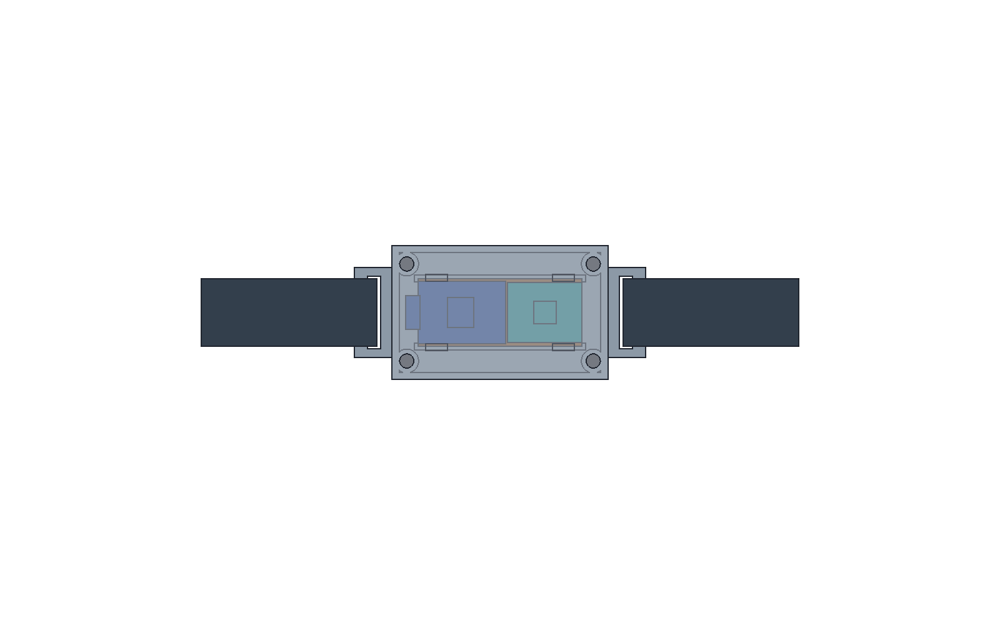

# ZOOP Journal

## Entry 1 — The idea and parts

**Date:** Not provided

**What I did:**

I wanted to make a DIY fitness band inspired by Whoop, using electronics I already had instead of buying another set of modules. I named it ZOOP because my name is Zack and ZHOOP was already taken.

My existing supplies are an ESP32-S3-Zero, a GY-MAX30102 optical pulse sensor, a GY-521 MPU6050 accelerometer/gyroscope, MSK-12C02 slide switches, a 2 × 8 cm perfboard and a heat-shrink tubing kit.

The goal became an experimental band that could estimate pulse, measure movement and expose the data without a subscription. It is not a Whoop-compatible device, and the current firmware does not implement recovery scores, strain scores, sleep staging or SpO₂.

### Planning the submission

I collected the design-submission requirements: a clear README, assembly and electronics images, editable CAD with STEP exports, PCB sources and Gerbers, firmware, and a linked CSV bill of materials.

There was initially confusion about whether the project needed to be built before requesting funding. I clarified that Fallen funds designs before construction. Finished-product photos and a demo video are therefore for the later build submission, not this design submission.

AI-use eligibility also came up during research. I stated that AI assistance is allowed for my project, and the documentation identifies the assistance rather than presenting generated work as entirely manual.

### Electrical design

The proposed wiring uses a shared I²C bus:

- GPIO5 connects to SDA on both sensors.
- GPIO6 connects to SCL on both sensors.
- All modules share ground.
- The MPU6050’s AD0 connects to ground, selecting address 0x68.
- The MAX30102 normally uses address 0x57.

The supply assumption is that both breakout boards accept the ESP32’s 3.3 V output. That still needs checking against my actual modules because similarly named breakouts can have different regulators and pull-up arrangements.

The slide switch was left unused. Some MSK-12C02 versions have a low current rating, so it should not be placed directly in the ESP32 power path without verifying its specifications.

For the first version, power comes through USB. An external protected USB power bank is included in the budget; there is no internal battery or charging circuit yet.

### Firmware development

Copilot generated Arduino firmware for the ESP32-S3. It reads infrared samples from the MAX30102 and acceleration and rotation from the MPU6050.

The firmware uses SparkFun’s MAX3010x library and its beat-detection function. It produces USB serial CSV containing elapsed time, raw infrared readings, a provisional contact flag, estimated BPM, acceleration in g and angular velocity in degrees per second.

Bluetooth advertises the device as ZOOP using the standard Heart Rate Service. A generic BLE client can subscribe to approximate BPM notifications. Motion data is currently available through USB only.

Several issues were addressed during development:

- The optical reading was changed to use the library’s FIFO sample API rather than repeatedly reading its newest value.
- Implausible beat intervals invalidate the previous estimate.
- Losing apparent contact clears the estimate.
- A sampling watchdog reports stalled optical data and invalidates stale readings.
- BLE advertising restarts after a client disconnects.
- Sensor initialization and MPU6050 read failures produce explicit error messages.

The contact threshold is only a starting assumption. It has not been calibrated on my sensor or validated for wrist use.

### Firmware checks

Local host-side tests simulated the sensor and BLE APIs. They checked pulse averaging, invalid intervals, contact loss, stalled sampling, sampling recovery, BLE notification contents, reconnect behavior and I²C error reporting.

These simulations were not treated as hardware tests.

A GitHub Actions workflow then installed pinned ESP32 and SparkFun dependencies and compiled the firmware for an ESP32-S3 target. The real firmware compilation passed. This confirms that the source builds, but not that it works correctly on my particular boards.

### CAD development

The first mechanical files were provisional box-based models. They had a significant problem: the modeled perfboard was wider than the 20 mm board I own, so it could not have been cut from that board.

The design was revised around a 44 × 18 mm carrier envelope. After CAD tooling was authorized, a real FreeCAD document and kernel-exported STEP files replaced the earlier provisional exports.

The assembly now contains the case, lid, carrier, optical retainer, reference models for the electronics, strap samples and screw envelopes. The case includes carrier supports, an optical aperture, strap slots and a USB opening.

FreeCAD checked that the modeled parts were valid solids. Each STEP file was reimported and compared with its source geometry. The assembly contained 13 solids, with no positive-volume intersections reported between them.

Those checks do not prove physical fit. The module models are reference envelopes rather than measured supplier models, and secure attachment for the ESP32 and GY-521 still needs completing. Wire routing, connector clearance, optical retention and printing tolerances also need further work.

### PCB development and checks

A small custom PCB was created as an alternative to hand-wiring the owned perfboard. It distributes power and I²C signals through three wire headers. It does not replace the development board or sensor modules.

The KiCad package includes the schematic, PCB, project and local-settings files, custom libraries and Gerbers. Actual schematic and PCB plots were exported for the README.

The first fabrication archive had been independently scripted. It was replaced with actual KiCad-generated copper, solder-mask, silkscreen, outline and drill exports.

Automated KiCad checks found issues that were corrected:

- PCB net names were aligned with the schematic.
- Footprint values were made consistent with schematic values.
- Silkscreen text was enlarged to satisfy the minimum-height rule.
- A long AD0 label was shortened so it no longer crossed the board edge.

The final KiCad ERC and DRC checks passed with zero reported violations, zero unconnected pads and zero schematic-parity issues. These checks still do not establish that the actual modules are electrically compatible or that a manufacturer has approved the files.

### Documentation, budget and repository

The README explains the project, wiring, firmware setup, design files, limitations and safety considerations. It includes the generated assembly image and actual KiCad plots rather than pretending they are photographs of a completed device.

The BOM lists the six supplies I already own with $0 requested. It also includes possible additional supplies such as wire, headers, a USB cable, printing, strap materials, screws and an external power bank.

The proposed perfboard-build budget is $75.75. Some amounts are published retail prices; printing, fastening hardware and shipping include provisional allowances that still need actual quotes. The optional custom PCB is excluded from that requested total.

The repository was created as techzt13/zoop. Firmware and design files were published there. It was initially private; a visibility change through the session integration failed, but a later check confirmed that the repository is now public.

### Current state and next steps

The project now has a public repository, firmware that compiles, editable FreeCAD and KiCad sources, STEP exports, design images, Gerbers and a linked BOM.

It is still an unbuilt digital prototype. Before treating the design as complete, I need to measure my actual modules, verify their voltage and pull-up requirements, finish component retention and wire routing, and replace budget allowances with appropriate quotes.

After funding and construction, the next stage will be testing the electronics off-body, characterizing the optical signal, assessing wrist placement and motion artifacts, and documenting the real results with photos and a demo. I will not use the experimental readings for medical or safety decisions.

**Photos:** CAD assembly render (not a photo of a completed device).

**Time spent:** 5.17 hours

## Entry 2 — BOM update

**Date:** Not provided

**What I did:**

ZOOP’s original BOM had rough allowances for the enclosure, screws, shipping, and tax. With Copilot’s help, the BOM was revised to link specific products and prices for wire, a USB cable, a power bank, strap materials, screws, and candidate assembly tools.

The listed merchandise subtotal is $141.69, but that isn’t the final build cost. Printing, shipping, tax, and any extra mounting materials still need quotes. The selected power bank has a low-current mode, although it hasn’t been tested with ZOOP yet.

The enclosure remains a draft based on approximate module dimensions. I can’t measure the parts yet, so the fit, mounting, and wiring will need to be checked once they’re available. The BOM currently marks six parts as owned; that needs correcting if they aren’t actually available.

**Photos:** CAD assembly render (not a photo of a completed device).

**Time spent:** 1.3 hours
