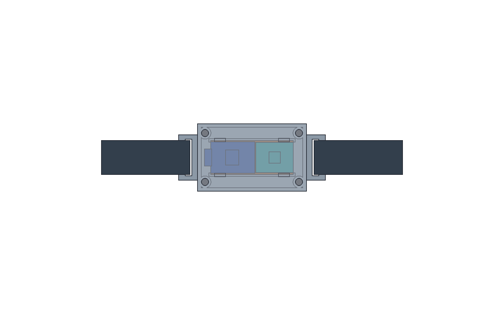
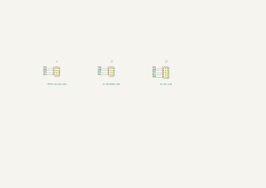
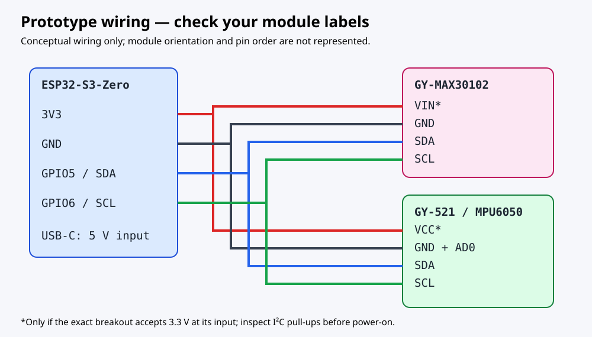

# ZOOP

**Zack's DIY fitness band. Your sensors. Your data.**

ZOOP is an original, Whoop-inspired experiment built around an ESP32-S3-Zero, a GY-MAX30102 optical pulse sensor and a GY-521 motion sensor. It streams an experimental heart-rate estimate over Bluetooth and pulse/motion data over USB. The goal is to understand wearable sensing using parts already on hand, rather than paying for a closed subscription.

**Design submission, not a finished build.** Dimensions for the actual modules still need measurement, and the device has not been assembled or tested on a wrist. ZOOP is independent of Whoop: it does not copy proprietary software, work with the Whoop app, or promise equivalent accuracy, battery life, sleep staging, recovery or strain scores.

## Full 3D assembly



Open the [FreeCAD assembly](cad/ZOOP_assembly.FCStd). [Assembly STEP](cad/assembly.step), individual part STEP files, modeling source, dimensions and mechanical validation details are in [cad/](cad/). Electronics are explicitly labeled reference-envelope models, not dimensionally certified supplier models.

## Electronics




The compact carrier distributes four signals to wire headers: 3.3 V, GND, SDA and SCL. It is an **alternative** to cutting and hand-wiring the owned perfboard, not a custom replacement for the sensor modules. Header numbers are carrier positions, not the modules' physical pin order.

The [KiCad project](electronics/wristband.kicad_pro), [schematic](electronics/wristband.kicad_sch), [PCB](electronics/wristband.kicad_pcb), local settings, libraries and [Gerber ZIP](electronics/gerbers.zip) are in [electronics/](electronics/README.md). The images are generated from the actual design, not build photos. Read the electrical validation and manufacturing limitations before ordering.

### Wiring



With power disconnected, wire by the **labels on your exact modules**:

| ESP32-S3-Zero | GY-MAX30102 | GY-521 |
|---|---|---|
| 3V3 | VIN/VCC, if verified 3.3 V compatible | VCC, if verified 3.3 V compatible |
| GND | GND | GND and AD0 |
| GPIO5 | SDA | SDA |
| GPIO6 | SCL | SCL |

The MAX30102 normally uses I²C address `0x57`; grounding MPU6050 AD0 selects `0x68`. Leave unused INT, XDA, XCL and other signals disconnected. The MSK-12C02 is listed as owned but **unused**: disconnect USB to turn this prototype off. Some versions are rated only 50 mA and must not switch ESP32 power directly.

**Breakout variants differ.** Inspect the actual regulators, LED supply and I²C pull-ups. SDA/SCL must not be pulled to 5 V, and the combined pull-up resistance must be suitable for the shared bus. Some GY-521 regulators will not operate reliably from a 3.3 V input. If either module cannot accept the assumed supply, revise the wiring and schematic before powering it; do not infer safety from its marketplace name.

## Build and use

1. Measure board outlines, thicknesses, header orientation, sensor position and USB plug clearance. Adjust the CAD parameters and regenerate exports before printing. Verify the actual electrical requirements above.
2. Choose **one** carrier: cut the owned perfboard to the modeled envelope, or order the checked custom PCB. Use insulated wires, trim header pins for clearance and label both ends. Check continuity and shorts with power disconnected.
3. Print and assemble using the [CAD instructions](cad/README.txt). The case has a carrier support and optical guide, but the ESP32 and GY-521 do not yet have modeled mechanical fasteners, and the optical retainer needs verification. Design and verify secure retention for all boards and the strap. The optical window must face the skin; validate retention and ambient-light shielding rather than covering the sensor lens with opaque material.
4. Compile and upload the firmware below. First test the electronics off-body on USB. Confirm both sensors initialize and that the optical stream changes when a stationary finger is placed over the lens.
5. For an experimental body-worn test, disconnect the mains-powered computer/charger and use an isolated, protected USB power bank outside the enclosure. Adjust the strap loosely enough for circulation. The current design has no internal battery or charging circuit.
6. Subscribe to ZOOP's standard BLE heart-rate service with a generic BLE client, or read USB serial for the full pulse/motion stream.

You need access to a soldering iron, solder, wire cutters, a multimeter, measuring tools and a printer or printing service. These tools are not assumed owned or funded; borrow them where possible. Add actual needed tools to the BOM before requesting funds.

## Firmware

Source: [firmware/ZOOP/ZOOP.ino](firmware/ZOOP/ZOOP.ino).

Install Arduino IDE or Arduino CLI, **Espressif ESP32 core 3.3.5**, and **SparkFun MAX3010x Pulse and Proximity Sensor Library 1.1.2**. Select the matching ESP32-S3 board and enable **USB CDC On Boot**. For a Waveshare board, follow its [Arduino instructions](https://docs.waveshare.com/ESP32-S3-Zero/Arduino). If flashing fails, use your board's BOOT/reset sequence.

The reproducible compile target used by [CI](.github/workflows/firmware.yml) is:

```sh
arduino-cli compile --fqbn esp32:esp32:esp32s3:CDCOnBoot=cdc firmware/ZOOP
```

The default generic ESP32-S3 target does not enable PSRAM; the firmware does not require it. Do not flash a different board's flash/PSRAM settings without checking your hardware.

Serial Monitor at **115200 baud** prints:

```text
ms,ir,contact,bpm,ax_g,ay_g,az_g,gx_dps,gy_dps,gz_dps
```

BPM is empty until plausible beat intervals have been collected. The starting contact threshold is uncalibrated. An optical-sampling stall or implausible interval invalidates the estimate; sensor initialization/read errors are reported explicitly. The MPU6050 scales are ±2 g and ±250 degrees/second. There is no onboard recording; save serial data on your computer if needed.

Over BLE, the device name is **ZOOP**, Heart Rate Service is `0x180D`, and Heart Rate Measurement is `0x2A37`. Enable notifications. Approximate BPM is sent about once a second when valid; no pulse estimate is sent when invalid. Your client must handle stale/absent notifications. Motion data is currently USB-only.

**BLE is unencrypted and not authenticated.** Nearby people may connect and read estimates. Use only with consent; this is not private health-data storage.

## BOM and funding

[BOM.csv](BOM.csv) includes links for every item, the six owned supplies at **$0 requested**, and a **$75.75 proposed build budget** for a perfboard build. Published retail prices are separated from provisional print, hardware and shipping allowances. The optional custom PCB is excluded from the requested total.

This is an estimate, not a supplier quote or grant approval. Confirm ownership of the remaining supplies, local pricing, printing costs, shipping, tax and the exact fasteners; reduce the request for anything else already owned. The USB power bank is an external pocket supply, not a Whoop-sized battery, and must be tested for low-current auto-shutoff.

## Validation and honest limitations

Firmware has a real ESP32-S3 compile in GitHub Actions and focused host-side tests. Host tests can be reproduced with:

```sh
g++ -std=c++17 -Wall -Wextra -Werror -Itests/stubs tests/firmware_test.cpp -o /tmp/zoop-test
/tmp/zoop-test
```

The FreeCAD solids and STEP round trips passed geometric checks; KiCad 9 ERC and DRC with schematic parity passed. Details and assumptions are documented beside the sources. Passing these and the firmware compile does **not** establish physical fit, electrical compatibility, reliable wrist pulse detection, manufacturing acceptance or safe prolonged wear. Complete board retention, wire routing and exact module measurements before calling the design finished.

**Not a medical device.** Motion, light, pressure, skin contact and sensor quality can make readings wrong. Do not use ZOOP for diagnosis, treatment, exercise safety decisions or emergencies. Never wear it connected to a mains-powered charger/computer; never connect a bare LiPo directly to USB, 5V or 3V3. Insulate joints, stop if anything warms or irritates skin, and keep this non-waterproof prototype away from sweat and water.

For a design review, verify your actual modules, update dimensions and prices. The repository is currently private; provide reviewers access or make it public before submitting. Program approval and funding are determined by Fallen organizers.

For a **build submission**, add genuine finished-product photos and a real demo-video link, document measured behavior, and update every source/export to match what was built. None are fabricated here.

## References and license

- [SparkFun MAX3010x library](https://github.com/sparkfun/SparkFun_MAX3010x_Sensor_Library): the included firmware calls its `heartRate.h` beat detector; library source and licensing remain upstream.
- [MAX30102 manufacturer information](https://www.analog.com/en/products/max30102.html).
- [MPU6050 manufacturer information](https://invensense.tdk.com/products/motion-tracking/6-axis/mpu-6050/).
- [ESP32-S3-Zero documentation](https://www.waveshare.com/wiki/ESP32-S3-Zero).

Original ZOOP source and documentation are [MIT-licensed](LICENSE). Supplier/module references are credited; their trademarks and designs belong to their respective owners.
